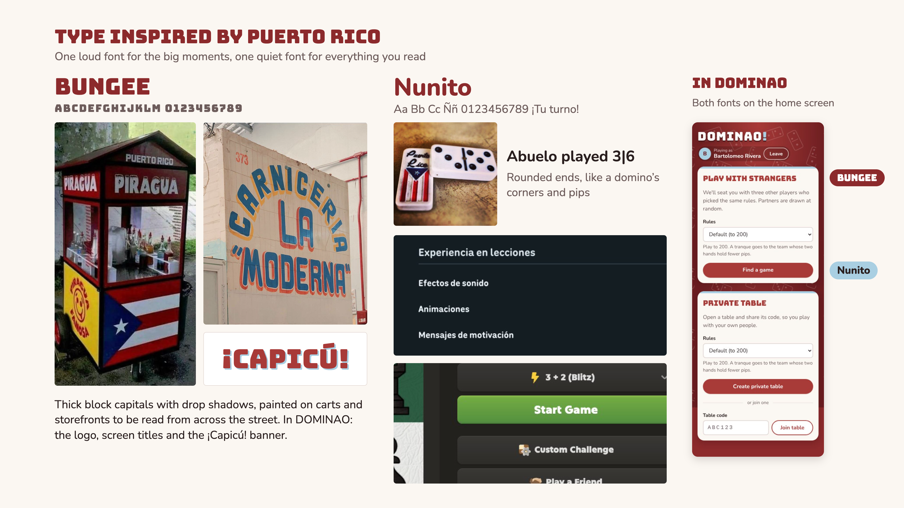
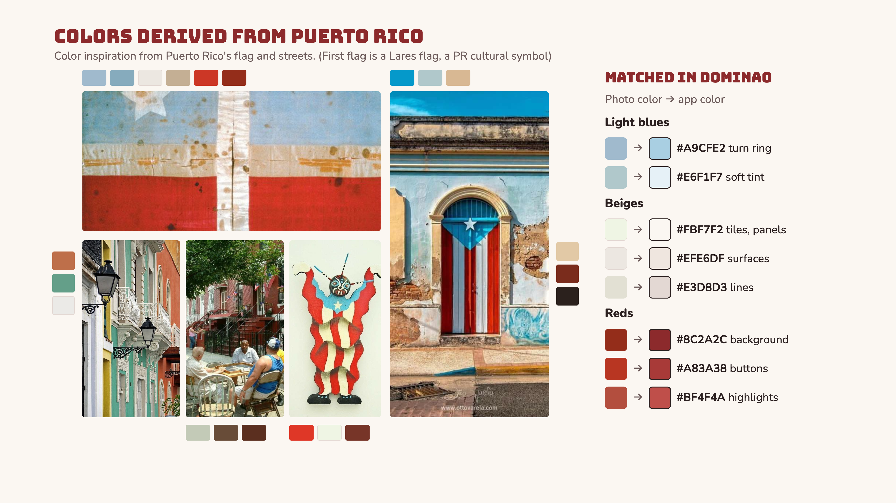

# DOMINAO

DOMINAO is an app for playing Puerto Rican dominoes online, with private tables for friends, public matchmaking for quick games, and guest sessions so nobody needs an account.

This README is the entry point. The first part is the P3 submission: the live app, the journey and its recording, the visual design study, and how to run and test the code. The second part is the P1 design, with each section linking to the Markdown file that holds it.

## P3 submission

| | |
|---|---|
| Deployed app | DEPLOY_LINK_HERE |
| Journey recording (YouTube) | YOUTUBE_LINK_HERE |
| Updated user journey | [below](#updated-user-journey) |
| Visual design study | [below](#visual-design-study) |
| Code | [src](src) (concepts, syncs, server) and [web](web) (Vue frontend) |
| Specs | [design](design) |
| Tests and their saved output | [tests](tests), [tests/output.txt](tests/output.txt) |

## Updated user journey

My grandpa, while on a bus taking him to the town plaza, is feeling a little bored and wants to play dominoes to kill the boredom. So he hops on DOMINAO and logs in as a guest, skipping sign-up and email confirmations. Because he has around 10 minutes until he gets to the plaza, he decides to play a quick match instead of the usual game to 200 points, so he chooses the ruleset he would like for the game and hops in a public lobby. After a few seconds, people queue in and a game starts, and he plays on until the game is over, just before arriving at the plaza. After his visit to a store, his brother calls him and tells him they need a fourth player for a match to 500 points, and sends him a code to join, which my grandfather uses to join the private table and play with his friends and family remotely.

The [recording](YOUTUBE_LINK_HERE) follows this journey in the deployed app. The original P1 journey is in [P1 TASKS/user_journey.md](P1%20TASKS/user_journey.md).

## Visual design study

**Typography.** Bungee, a loud signage font, for the big moments (logo, titles, the ¡Capicú! banner), inspired by hand-painted Puerto Rican street signs. Nunito, a rounded sans-serif, for everything you read, in the style of friendly game apps.



**Color.** Light blues, beiges and reds sampled from the Lares flag, the Puerto Rican flag and Old San Juan streets, each matched to the app color it became.



## Running the app

You need [Bun](https://bun.sh) 1.4 and a MongoDB server.

```sh
bun install
MONGODB_URL=mongodb://127.0.0.1:27017/dominao bun run start   # the whole app on http://localhost:3000
```

`bun run dev` does the same with a local Mongo in a container (Podman) and reloads on changes. `bun run preview` runs it exactly as the class platform does.

## Testing

```sh
bun run test:save        # runs every test and saves the output to tests/output.txt
bun run check            # the sync-engine checks and the TypeScript compiler
bun run check:design     # checks the specs in design/ against each other
```

`bun test` needs MongoDB too; `bun run test:memory` starts a throwaway one in memory instead. The last saved run is in [tests/output.txt](tests/output.txt).

| Tests | What they cover |
|---|---|
| [tests/concepts](tests/concepts) | Each concept on its own, through its actions and queries only: every action, its refusals, and the principle. Game rules are tested with seeded deals ([tests/support/dominoes.ts](tests/support/dominoes.ts)), so no test writes to the database. |
| [tests/compositions](tests/compositions) | The HTTP API end to end: journeys (open a table, three friends join, play a whole game to 200; four strangers matched and seated), who may do what, and the error each refusal returns. |
| [tests/web](tests/web) | The board layout: no tiles overlap, every tile touches the one before it, turns and doubles. |

## Specs and API

- Concept specs: [design/concepts](design/concepts). Composition specs: [design/compositions](design/compositions). Shared types: [design/types.md](design/types.md).
- Every endpoint, its input, output and errors: [generated/dominao.md](generated/dominao.md), generated from the code by `bun run generate`.
- How each step was built and checked, and the review against the course rubrics: [design_notes.md](design_notes.md).

## Known limitations

- Guests only: there are no accounts, so a guest who clears their browser storage loses their seat.
- If every player in a full matchmaking lobby closes the page during the countdown, the lobby waits until one of them opens the page again, since launching is asked for by the page. Other guests are put in a fresh lobby meanwhile.
- The score card shows the last match's result only; the move log has every move.

# P1 design

## Contents

1. [Problem framing and stakeholders](#1-problem-framing-and-stakeholders)
2. [Application pitch](#2-application-pitch)
3. [Concept specifications, essential reactions, and design note](#3-concept-specifications-essential-reactions-and-design-note)
4. [UI sketches](#4-ui-sketches)
5. [User journey](#5-user-journey)

---

## 1. Problem framing and stakeholders

📄 [problem_framing.md](P1%20TASKS/problem_framing.md)

- [Domain](P1%20TASKS/problem_framing.md#domain)
- [Bad situations](P1%20TASKS/problem_framing.md#bad-situations)
- [Corroboration](P1%20TASKS/problem_framing.md#corroboration)
- [Workarounds and comparables](P1%20TASKS/problem_framing.md#workarounds-and-comparables)
- [Solution sketch](P1%20TASKS/problem_framing.md#solution-sketch)
- [Stakeholder list](P1%20TASKS/problem_framing.md#stakeholder-list)

## 2. Application pitch

📄 [app_pitch.md](P1%20TASKS/app_pitch.md)

A short pitch for DOMINAO and its three core features: Private Tables, Public Matchmaking, and Guest Sessions.

## 3. Concept specifications, essential reactions, and design note

📄 [concept_design.md](P1%20TASKS/concept_design.md)

- **Concept specifications:** [GuestSessioning, CodeGenerating, Matchmaking, Table](P1%20TASKS/concept_design.md#concepts)
- **Essential reactions:** [Guest sessions and private tables](P1%20TASKS/concept_design.md#reactions)
- **Design note** (the role of each concept): [Design Note](P1%20TASKS/concept_design.md#design-note)

## 4. UI sketches

🖼️ [ui_sketches.jpg](P1%20TASKS/ui_sketches.jpg)


## 5. User journey

📄 [user_journey.md](P1%20TASKS/user_journey.md) (the P3 version is [above](#updated-user-journey))

The story of a grandfather in chemotherapy who plays quick public games, then opens a private table with his brothers using a join code.
